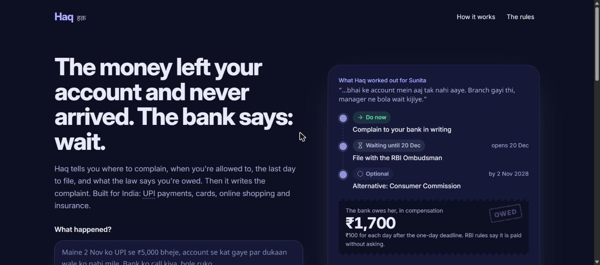
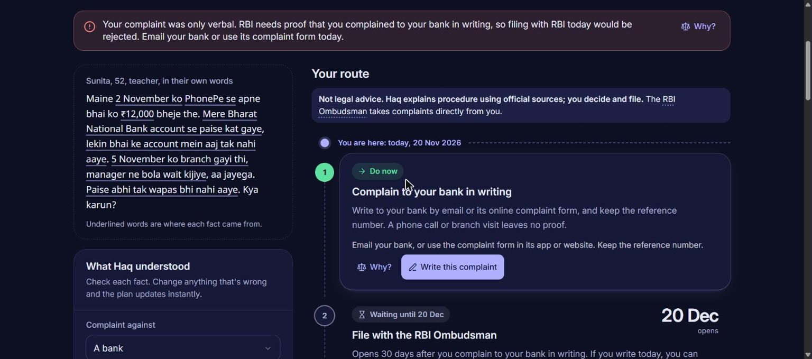
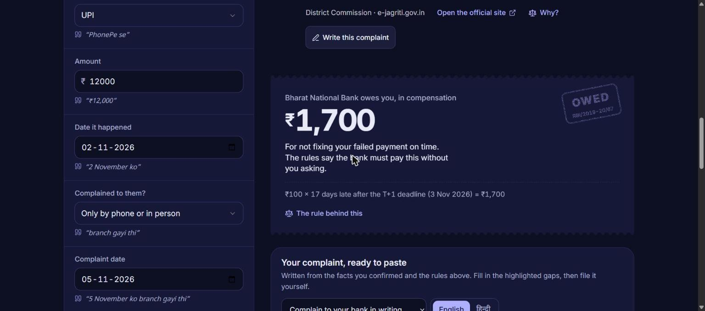
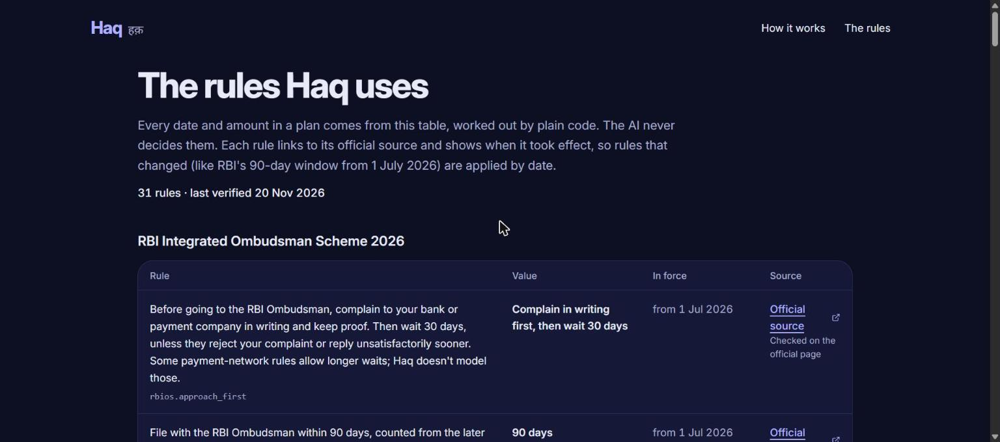
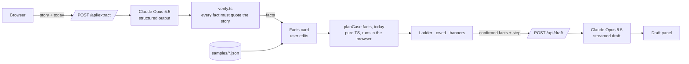
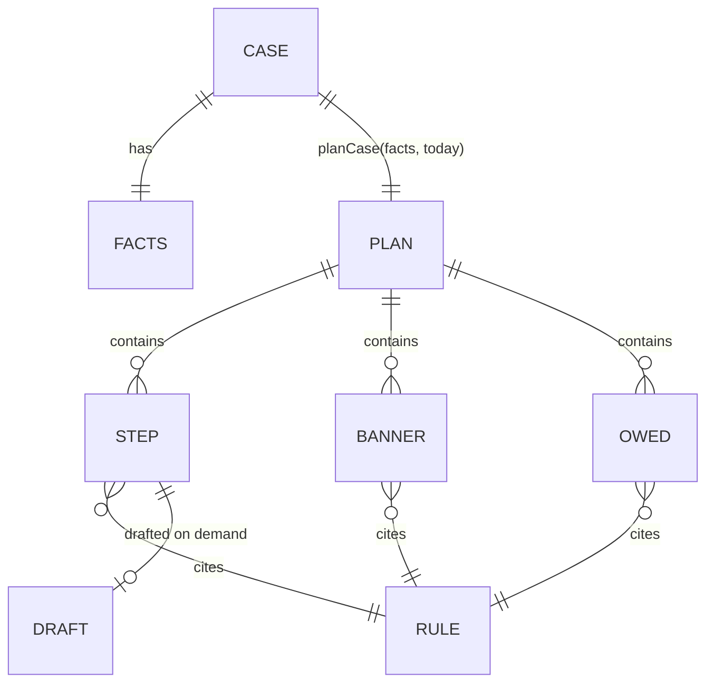

# Haq · हक़

**The law already gives you rights. Haq gives you the route.**

Tell Haq what went wrong with your bank, payment app, online shop or insurer, in Hindi, English or Hinglish. It works out **where to complain, whether you're allowed to yet, the last day to file, and what the rules say you're owed**, then writes the complaint for you to file.

**Live demo:** _add after deploy_ · **Video:** _add after upload_ · Built for the Creators AI Winter Challenge 2026.



> Not legal advice. Haq explains procedure using official sources; you decide and file. All sample people, banks, shops and insurers are fictional.

---

## The problem

The money left your account and never arrived. The bank says: wait. Most people don't know there is a fixed deadline for fixing that, that the bank owes them money for every day it's late, or which official body to escalate to, and when.

- RBI's Ombudsman received **13.34 lakh complaints in FY25**. Of 9.11 lakh complaints handled at RBI's central receipt centre in FY25, 7.84 lakh were closed as non-maintainable or non-complaints ([Tribune](https://www.tribuneindia.com/news/business/rbi-ombudsman-sees-13-34-lakh-complaints-in-fy25-loans-credit-cards-dominate)).
- The National Consumer Helpline averaged **1,70,585 complaints a month in 2025** ([FPJ](https://www.freepressjournal.in/business/national-consumer-helpline-receives-one-lakh-complaints-per-month-hike-in-grievance-registration-through-whatsapp)).
- Each official portal handles one forum and assumes you already know you belong there. We found no tool that routes across forums.

(1 lakh = 100,000. UPI is India's instant-payment system.)

## What Haq does

1. **Reads your story.** AI extracts the facts into a card you can edit. Every fact shows the exact words it came from, and code drops any fact whose words aren't in your story.
2. **Plans your route.** A date-aware rules engine, written in plain TypeScript, decides the forum, when each step opens, every deadline and any compensation owed. Each step links to its official source.
3. **Shows what you're owed.** For example, RBI's rule on failed UPI transfers: if it's not fixed by the day after the payment (T+1), the bank owes **₹100 a day** without being asked. Sunita's case comes to ₹1,700.
4. **Writes the complaint** for the step you're on, field by field, ready to paste. Missing details become placeholders like `[ACCOUNT LAST 4 DIGITS]`.

It covers three areas: **banking and payments** (RBI Integrated Ombudsman Scheme 2026, failed-transaction compensation, fraud liability), **shopping and services** (E-Commerce Rules 2020, National Consumer Helpline, consumer commissions) and **insurance** (Insurance Ombudsman, Bima Bharosa).

| The route, with a "you are here" line | What the bank owes, with formula and source | Every rule, public |
|---|---|---|
|  |  |  |

## Try it

- **Live:** open the site and click a sample case. Samples open instantly and need no API key.
- **Locally**, in 3 commands (Node 22+):

```bash
git clone <this repo> haq && cd haq
npm install
npm run dev          # http://localhost:3000; samples work without a key
```

To run live analysis, copy `.env.example` to `.env.local` and set `ANTHROPIC_API_KEY`.

| Variable | Default | Purpose |
|---|---|---|
| `ANTHROPIC_API_KEY` | none | Server-only. Without it, Haq runs on samples only |
| `HAQ_MODEL` | `claude-opus-5-5` | Model for both calls |
| `HAQ_EFFORT` | `medium` | Effort level (set explicitly) |
| `RATE_LIMIT_PER_HOUR` | `10` | Extractions per IP per hour (drafts: 2×) |
| `DEMO_MODE` | `false` | `true` makes the app samples-only (a kill switch) |

## How it works

**AI reads and writes. Code decides.** The model never decides anything with legal consequence.



```mermaid
sequenceDiagram
  participant B as Browser
  participant X as /api/extract
  participant C as Claude
  participant R as planCase (browser)
  participant D as /api/draft
  B->>X: story, today
  X->>C: system rules + <story>untrusted</story>, FactsSchema
  C-->>X: facts, each with an evidence quote
  X->>X: drop facts whose quote isn't in the story
  X-->>B: facts
  B->>R: facts (user may edit; re-plans instantly)
  R-->>B: track, steps, dates, owed, banners, each with a ruleId
  B->>D: confirmed facts, step id
  D->>D: re-run planCase on the server
  D->>C: facts + engine figures + rule texts (never the story)
  C-->>B: streamed SUBJECT / DESCRIPTION / RELIEF / DOCUMENTS
```

- **Extraction** (`lib/extract.ts`): `messages.parse` with a zod schema, effort set explicitly, server-side refusal fallback (`fallbacks: "default"`), `stop_reason` checked before reading content, and one retry if the output doesn't match the schema. The story is wrapped in `<story>` tags and the system prompt declares it untrusted. The schema has no field for full account or card numbers.
- **Verification** (`lib/verify.ts`): normalises Unicode (NFC), quotes, whitespace and case, then checks each fact's evidence is a substring of the story. Unmatched or invalid facts are set to `null` and counted in `dropped`; the user is asked about them instead.
- **Rules engine** (`lib/rules/`): `planCase(facts, today)` is pure and has no date library. Rules are versioned by effective date (the RBI Ombudsman's 90-day window from 1 Jul 2026; the fraud-liability rules switch on 1 Jan 2027). It runs in the browser, in tests and in evals.
- **Drafting** (`/api/draft`): the server re-plans from the confirmed facts, so the figures the model cites come from the engine and not the client. If the model is unavailable, a static template is shown instead.

More in [docs/architecture.md](docs/architecture.md).

## The rules

All 31 rules live in [`lib/rules/sources.ts`](lib/rules/sources.ts) as `{ id, law, summary, value, sourceUrl, effectiveFrom, effectiveTo?, status }`, rendered publicly at **`/rules`** (last verified 20 Nov 2026). Only values verified on an official page (V), or via a source quoting the official text (S), ship. Every Step, Banner and Owed object carries a `ruleId`; TypeScript and a test both guarantee it exists.

| Area | Key values | Source |
|---|---|---|
| RBI Ombudsman (RB-IOS 2026) | Complain in writing first; wait 30 days (less if rejected); file within 90 days | [RBI FAQ](https://www.rbi.org.in/commonman/Upload/English/FAQs/PDFs/RBIOS01072026.pdf) |
| Failed transactions | UPI/IMPS T+1, ATM/PoS/online card T+5; then ₹100/day, paid without being asked | [RBI/2019-20/67](https://www.rbi.org.in/scripts/NotificationUser.aspx?Id=11693) |
| Fraud liability (before 2027) | Zero loss if reported within 3 working days; capped at ₹5k/10k/25k on working days 4–7 | [RBI/2017-18/15](https://www.rbi.org.in/scripts/NotificationUser.aspx?Id=11040) |
| Fraud liability (from 1 Jan 2027) | Zero loss if reported within 5 calendar days; resolve in 45 days | [RBI/2026-27/167](https://www.rbi.org.in/Scripts/BS_CircularIndexDisplay.aspx?Id=13543) |
| E-commerce | Acknowledge in 48 h; resolve in 1 month | [E-Commerce Rules 2020](https://egazette.gov.in/WriteReadData/2020/220661.pdf) |
| Consumer commissions | 2-year limit; District ≤ ₹50 L, State ≤ ₹2 cr; fee nil up to ₹5 L | [CPA 2019](https://egazette.gov.in/WriteReadData/2019/210422.pdf), [fees](https://egazette.gov.in/WriteReadData/2023/248158.pdf) |
| Insurance Ombudsman | Complain first; wait 1 month; file within 1 year; up to ₹50 L | [CIOINS](https://cioins.co.in/Complaint/Online) |

Where the law is ambiguous, Haq picks the safer reading, marks it `// Haq convention:` in the code and lists it on `/rules`. For example: working days are Mon–Sat excluding Sundays and the 2nd and 4th Saturdays, with holidays ignored; and after an early rejection, the 90-day window counts from that rejection.

**To update a rule:** edit one entry in `sources.ts` and add a dated test in `tests/rules/`.

## Evaluation

20 fictional stories (8 banking including 3+ Hinglish, 7 consumer, 5 insurance), hand-labelled with the facts, the track and the current-step status, in [`evals/stories/`](evals/stories). Run `npm run eval` (needs a key; ≈ $0.45). Full results are in [`evals/RESULTS.md`](evals/RESULTS.md).

| Eval | What it checks | Result | Target |
|---|---|---|---|
| EVAL-1 | Entity, transaction type, problem (exact match) | **100%** | ≥ 90% |
| EVAL-1 | Amounts, transaction date, complaint date (exact match) | **100%** | ≥ 85% |
| EVAL-2 | Facts shown that don't quote the story | **0** (0 of 201 dropped pre-verification) | 0 |
| EVAL-3 | Deliberately missing fields left empty | **8/8** | ≥ 90% |
| EVAL-4 | Correct track **and** current-step status, end to end | **20/20** | ≥ 18/20 |

Model `claude-opus-5-5`, effort `medium`; median extraction 5.2 s, p95 7.2 s. **Caveat:** the stories are synthetic and were written to the same labelling guide the prompt uses, so this is a sanity check, not proof of real-world accuracy.

## Tests

```bash
npm test        # 98 Vitest cases: rules engine (dated cases incl. leap years, 2nd/4th Saturdays,
                # the 1 Jul 2026 and 1 Jan 2027 switches), evidence verification, API validation, .ics, share links
npm run lint
npm run build
```

Lighthouse accessibility: 96–100 on every page; best practices 100. No horizontal scroll at 360 px.

## Tech stack

Next.js 16 (App Router, Turbopack) · TypeScript · Tailwind CSS 4 · shadcn/ui (Base UI) · `@anthropic-ai/sdk` (Claude Opus 5.5) · zod · Vitest · `motion` (count-up and shimmer, from Magic UI and Motion Primitives, MIT). No database, no auth, no agent framework, no vector DB.

## Data model and API



There are no tables: these are typed documents (zod/TypeScript), and the case lives in the URL hash and sessionStorage. The API reference is in [docs/api.md](docs/api.md): `POST /api/extract` and `POST /api/draft`.

## Privacy and safety

- **Nothing is stored on a server.** No database and no accounts. Logs hold only route, status, latency and token counts, never story text or facts.
- **The case lives in your browser tab** (sessionStorage). The opt-in share link puts the facts, never the story, in the URL hash, which is not sent to servers.
- **Only the last 4 digits** of any account or card are asked for. The extractor has no field for full numbers.
- **Prompt injection:** the story is declared untrusted data, outputs are schema-bound and evidence-verified, the model has no tools, and the drafting call never sees the story.
- **Abuse:** a per-IP limit (10 extractions/hour), an Anthropic Console spend limit, and a `DEMO_MODE` kill switch.
- **Not legal advice.** Haq shows procedure and sources and never says you'll win. Cases over ₹2 crore, or with every window closed, are pointed to a lawyer or free legal aid.

## Built with AI assistance

Disclosed under the challenge rules (§4).

- **At runtime:** Claude Opus 5.5 via the Anthropic API makes two calls per case: extraction and drafting. Everything else, including routing, eligibility, dates, money and the facts card, is deterministic code.
- **During development:** this repository was written with substantial help from an AI coding assistant (Claude Code), working from our product and rules blueprint. That covers the code, tests, the 20 eval stories and these docs.
- **What we checked ourselves:** we chose the problem and scope, researched the rule values and their official sources, and set the binding test cases. We reviewed the generated code, and the rules engine is pinned by 80+ dated unit tests. The eval stories were reviewed against the labelling guide, and we tested the app by hand on desktop and at 360 px.

## Limitations and what's next

- Public holidays are ignored, and longer waits allowed by some payment networks aren't modelled.
- RBI Ombudsman coverage limits for NBFCs aren't checked; the user is told to confirm.
- After the zero/limited fraud windows, Haq states no loss figure (the bank's own policy applies).
- The eval set is small and synthetic. Real user testing hasn't been done yet.
- **Next:** telecom, securities (SEBI SCORES) and airline complaints; WhatsApp access; more Indian languages; partnerships with legal-aid NGOs.

## Credits and licence

MIT, see [LICENSE](LICENSE). Uses shadcn/ui, Base UI, Magic UI's NumberTicker and Motion Primitives' TextShimmer (MIT), lucide icons, and Mermaid (loaded from a CDN on `/how-it-works`). Rule sources: RBI, the Gazette of India, the Department of Consumer Affairs, CIOINS and IRDAI, as linked on `/rules`.
