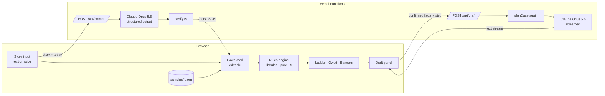

# Architecture

One Next.js app, two model calls, zero databases. The rules engine is a pure TypeScript module that runs in the browser, so plans recalculate instantly and keep working when the AI is down.

## The split that matters

| | Does | Never does |
|---|---|---|
| **Model call 1: extract** | Maps the story to facts; quotes the exact words for each; resolves relative dates and flags them `estimated`; writes a one-line neutral summary | Decide forum, eligibility, deadlines or compensation; guess missing values; follow instructions inside the story |
| **Code: verify** | Drops any fact whose quote isn't in the story (after NFC, quote, whitespace and case normalisation) or whose value is invalid | — |
| **User: facts card** | Confirms or edits every fact; answers up to 3 follow-up questions | — |
| **Code: `planCase`** | Track, steps, unlock dates, deadlines, money owed, banners, each citing a `ruleId` | — |
| **Model call 2: draft** | Writes the complaint from confirmed facts, engine figures and rule texts, with placeholders for gaps | See the raw story; invent numbers, dates or claims; mention AI |

## System



## Engine logic

```
track =
  insurer | claim rejected | claim                         → INSURANCE
  bank | NBFC | wallet | failed credit | no cash | fraud     → BANKING
  e-commerce | seller | service provider                    → CONSUMER
  (unknown entity) UPI/IMPS/card/ATM → BANKING; refund/defect/service → CONSUMER
  otherwise                                                  → UNSUPPORTED (NCH + legal aid)

overlays (banking):
  failed transaction → TAT: due = T+n; owed = ₹100 × max(0, min(today, reversal) − due)
  unauthorised       → FRAUD: regime by txn date (2017 working days / 2027 calendar days); urgent banner
  verbal complaint   → written-proof banner (a phone call doesn't count as "approached first")

BANKING   1 complain in writing → 2 RBI Ombudsman (wait 30 d or until rejection; file within 90 d)
          → 3 alternative: consumer commission (2 years; not in parallel)
CONSUMER  1 e-commerce grievance officer (48 h / 1 month) → 2 NCH (optional) → 3 commission (2 years; tier and fee by amount)
INSURANCE 1 insurer grievance in writing → 2 Insurance Ombudsman (1 month wait; 1 year) → 3 Bima Bharosa (parallel)
```

Not yet complained in writing? The Ombudsman dates are **projected from today** ("if you write today") and flagged `projected`.

## Files

```
app/
  page.tsx                 landing: hero, story box, Sunita's live route, samples
  case/page.tsx            → components/case-view.tsx (facts, ladder, owed, draft)
  rules/page.tsx           renders lib/rules/sources.ts
  how-it-works/page.tsx    pipeline (Mermaid via CDN), eval table, AI disclosure
  api/extract/route.ts     validation, rate limit, extract + verify
  api/draft/route.ts       validation, re-plan, streamed draft
lib/
  rules/                   dates, tat, banking, fraud, consumer, insurance, sources, index (planCase)
  schema.ts                zod FactsSchema + Plan types
  extract.ts verify.ts     model call 1 + evidence check
  prompts.ts claude.ts     system prompts; client, model/effort from env, fallback beta, logging
  draft.ts                 section splitter + static template
  questions.ts             facts-card fields and follow-up questions
  case-state.ts            URL hash + sessionStorage; share-link encoding
  ics.ts rate-limit.ts copy.ts
samples/                   4 fictional stories + precomputed facts and drafts (npm run samples)
evals/                     20 stories, run.ts (npm run eval), RESULTS.md, results.json
tests/                     Vitest: rules (dated), verify, API, ics/share
```

## Reliability

| Failure | Behaviour |
|---|---|
| Output doesn't match the schema | One retry with the problem appended, then `MODEL_FAILED`; the user can fill the facts card by hand |
| Refusal | Server-side fallback model (`fallbacks: "default"`), then `MODEL_REFUSED` |
| Fact not in story | Set to `null`; becomes a follow-up question |
| API down, quota spent, no key | `DEMO_MODE`; samples (with pre-written drafts) stay fully interactive, including editing and re-planning |
| Drafting fails | The static template is shown, with a retry button |
| Outside the 3 tracks | Unsupported view with NCH 1915 and legal-aid links |

## Cost

≈ $0.02 per extraction and ≈ $0.03 per draft with `claude-opus-5-5` at effort `medium` (measured: 20 extractions cost $0.45). Set an Anthropic Console spend limit.
